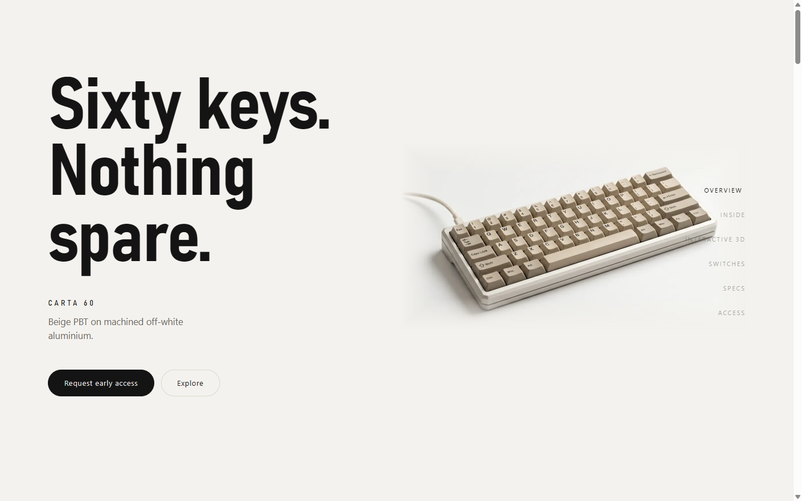
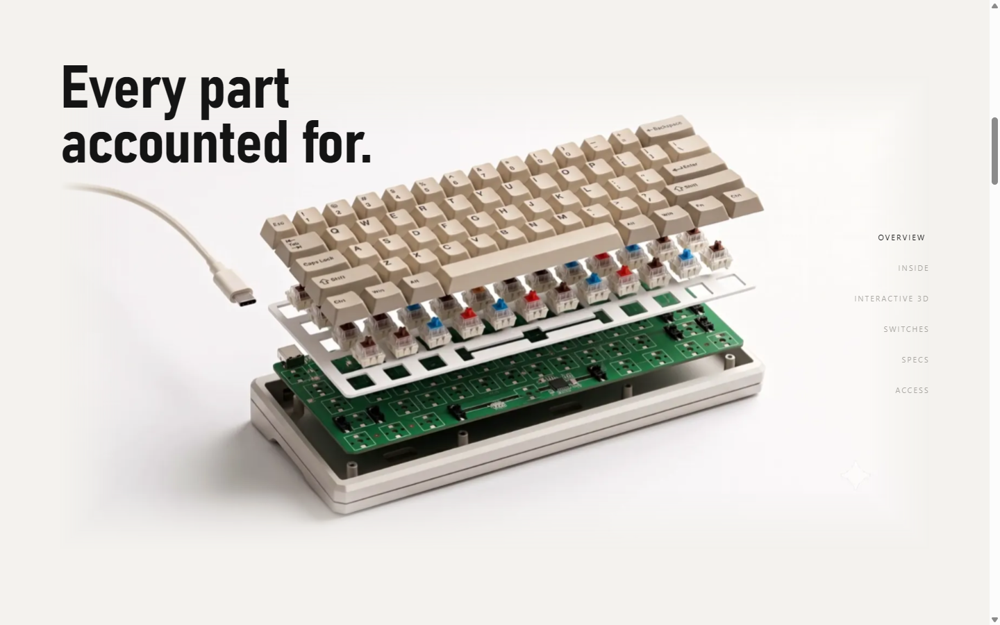
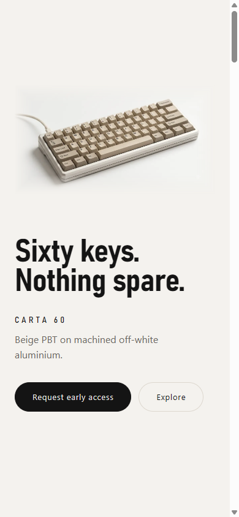

# CARTA 60

Single-page product site for an original 60% mechanical keyboard — beige PBT keycaps, off-white
aluminium case. Apple-register, light-themed, custom-coded. A showcase piece, not a store.

Vanilla HTML/CSS/JS. No framework, no build step, no bundler. GSAP + ScrollTrigger and Three.js are
all vendored locally.

Almost every "3D" moment on the page is pre-rendered playback — the hero is a still and the
assembly centrepiece scrubs a WebP frame sequence on `<canvas>`. The **Interactive 3D** section is
the single exception: a real WebGL scene you can rotate and zoom. It is lazily loaded and pauses
when off-screen, so the rest of the page pays nothing for it.

---

## Running it

```bash
node serve.js          # -> http://localhost:8000
node serve.js 3000     # any port
```

`serve.js` is a ~40-line zero-dependency static server included because the `python` on this
machine is the Microsoft Store alias stub, not an interpreter. Any static server works —
`npx serve .` is equivalent.

It must be **served, not opened as `file://`**. ES modules and the frame fetches both fail under
the file protocol.

---

## Publishing

```powershell
powershell -ExecutionPolicy Bypass -File package-deploy.ps1
```

Produces `carta-60-deploy.zip` (~8.2 MB, 177 files). Drag it onto
**https://app.netlify.com/drop** — no account needed to deploy, though claiming the site is what
lets you keep the URL and redeploy over it.

The zip excludes `assets/reference/` — 34 MB of masters the page never requests. Pass
`-IncludeMasters` if you want them downloadable from the live site too.

**After the first deploy**, replace the placeholder host in the `og:image` and `twitter:image`
tags in `index.html` with the real URL Netlify assigns. Social scrapers ignore relative image
paths, so link previews stay blank until that points somewhere real. Everything else works
regardless.

**Also after the first deploy**, finish wiring lead capture — three clicks in the Netlify UI, no
code. See [Lead capture](#lead-capture) below.

Two deployment details worth keeping:

- **`package-deploy.ps1` builds the zip entry-by-entry on purpose.** Windows PowerShell 5.1's
  `Compress-Archive` writes entry names with backslash separators, which the ZIP spec forbids
  (4.4.17.1). A spec-compliant unpacker turns those into flat files literally named
  `assets\hero\hero.webp`, and the deployed site 404s on every asset. Verified fixed: 177 entries,
  zero backslashes.
- **`netlify.toml` caches `/assets/*` for 30 days, not a year.** Frame filenames are not
  content-hashed — `frame_0000.webp` keeps its name across rebuilds — so `immutable` would strand
  visitors on stale frames after a re-render.

---

## Lead capture

The page has exactly one call to action — **Request early access** — placed twice: the hero pill
and the closing band under the form. Both scroll to the same `#access` section and focus its first
field. Nothing else on the page asks the visitor for anything, which is the whole point: a second,
differently-worded ask splits the intent it was meant to capture.

### Where a submission actually goes

```
visitor fills form
   │  js/form.js validates (required fields + email shape); invalid → inline errors, no request
   ▼
POST / on the site's own origin        ← not a third-party domain; no API key in the page
   body: application/x-www-form-urlencoded, including form-name=early-access
   │
   ▼
Netlify's edge sees a POST whose form-name matches a form it detected at DEPLOY time,
swallows the request before it reaches the static site
   │
   ├──► stores name / email / message + its own created_at timestamp + source IP
   │       → Netlify dashboard → site → Forms → early-access  (the running list, CSV-exportable)
   │
   └──► fires a notification email, one per submission
```

Netlify finds the form by **parsing the deployed HTML** for `data-netlify="true"`. That is the
single load-bearing fact here, and it has two consequences worth stating plainly:

- The form markup must be static in `index.html`. A form injected by JS is invisible to that scan,
  and its POSTs come back 404 with no other explanation.
- Detection happens at deploy. A form that has never been deployed does not exist as far as the
  edge is concerned — which is why nothing about this can be tested locally.

Chosen over Formspree or a serverless function writing to a Google Sheet because the site was
already deployed to Netlify: the backend is a property of hosting that already existed. No new
account, no secret to store, no function to maintain, no extra network hop, and it satisfies both
"email me" and "keep a running list" with one setting. The free tier covers 100 submissions/month.

### The manual setup, once

1. Deploy, then **claim the site into a Netlify account**. An anonymous Drop deploy has no
   dashboard to show an inbox and no address to notify — the submissions go nowhere you can read.
2. Site → **Forms** → confirm `early-access` appears. If it does not, the form was not in the
   deployed HTML; check that `data-netlify="true"` and the hidden `form-name` input both survived.
3. Site → Forms → **Form notifications** → Add notification → **Email notification** → the address
   that should receive each lead.

### Testing it locally

You can test everything except success. `serve.js` answers any non-GET with **405**, deliberately:
before that guard it returned 200 and `index.html` for a POST, `fetch` saw `res.ok`, and the page
cheerfully showed "Thanks — we'll be in touch" for a lead that had gone nowhere. A dev server that
fakes a success is worse than one that refuses.

So locally: validation, error states, keyboard flow and the failure copy are all real. To inspect
the success state, set `FORM.devEcho = true` in `js/config.js` — it skips the network entirely.
**Set it back to `false` before packaging**; left on, it silently discards every real lead.

### Design notes

- **Underlines, not boxes.** Full-bordered inputs put three heavy rectangles on a page built from
  whitespace and hairlines, and they immediately become the loudest objects on it.
- **Errors are copy and weight, not colour.** The palette has one accent and no error hue. A red
  here would be the most saturated thing on the page, out-shouting the product.
- **Honeypot is off-screen, not `display:none`.** Bots skip fields they can tell are unrendered,
  and it only works if they fill it in. `aria-hidden` + `tabindex="-1"` keep humans away from it.
- **No-JS still works.** Without scripts the form posts natively to Netlify and lands on its
  generic success page — degraded, not broken. `js/form.js` intercepts submit only so the visitor
  never leaves a page whose entire argument is continuity.

---

## The one decision that matters

The scroll-assembly centrepiece scrubs a **WebP frame sequence on `<canvas>`**, not a `<video>`.

Setting `video.currentTime` forces the decoder to seek to the preceding keyframe and decode
forward on every scroll tick. Scrubbing forward is merely uneven; scrubbing *backward* is
pathological, because each step re-decodes from an earlier keyframe. Pre-decoded frames blitted
with `drawImage()` have no per-tick decode cost at all and reverse exactly as cheaply as they
advance. It is also the only approach that behaves identically on iOS Safari, so there is no
separate mobile code path to maintain.

This is the same conclusion the earlier Skullcandy build reached the hard way; it is baked in here
from the start.

**No `<video>` element ships on this page at all.**

---

## Assets

### Masters (`assets/reference/`) — the files you supplied

| File | Content |
|---|---|
| `assembly-master.mp4` | Exploded → assembled, 1948×1060, 24 fps, 4.04 s, **97 frames** |
| `hero-still.png` | Assembled board, 3/4 view — 2816×1536 |
| `detail-switch.png` | Single switch with keycap lifted |
| `detail-topdown.png` | Full board from directly above |
| `detail-profile.png` | Board in profile |
| `exploded.png` | Exploded still — used for the social card |

Nothing under `assets/reference/` is served. It is the input to the build script.

### Rebuilding the served assets

```bash
bash build-assets.sh
```

Idempotent — re-run it after replacing any master. It regenerates:

| Output | Spec |
|---|---|
| `assets/assembly/frame_0000…0096.webp` | 1600 px wide, WebP q78, **97 frames**, ~5.0 MB total |
| `assets/assembly-mobile/frame_0000…0048.webp` | 1200 px wide, q76, every other frame — 49 frames, ~2.1 MB |
| `assets/hero/hero.webp` + `hero@1200.webp` | 2400 / 1200 px, q82 |
| `assets/hero/og-share.webp` | 1200×630 hard crop, no feathering |
| `assets/detail/detail-01…03.webp` | 1800 px wide, q80 |

Two things in that script are load-bearing:

- **`-c:v libwebp` is not optional.** Given a multi-frame input and a `.webp` output pattern,
  ffmpeg otherwise selects `libwebp_anim` and silently writes a *single animated file* instead of
  a numbered sequence.
- **`-fps_mode passthrough`** emits every real frame — no duplication, no drops. The source has 97
  frames, which is why the sequence is 97 and not a round 120. Resampling up to a rounder number
  would duplicate frames, and duplicates read as stutter during a scrub.

**If you replace the assembly master**, the script prints the new frame count. Update
`FRAMES.count` and `FRAMES.mobileCount` in `js/config.js` to match — that is the only wiring.

### Why the assets are alpha-feathered

Your renders sit on a soft neutral studio gradient (≈`#e7e8e7` at the edge, `#f8f8f8` at centre),
not a flat colour. Against the page's warm off-white ground that would show a visible rectangle at
every image boundary. `build-assets.sh` feathers the outer 110 px of every served still and frame
to transparent and warms the neutral field very slightly (`bb=0.99`), so each asset dissolves into
the background at any viewport width. The canvas paints `--c-bg` beneath each frame, so the blend
holds there too.

The social card is deliberately *not* feathered — it composites onto unknown backgrounds.

### The 3D model

```bash
bash build-model.sh                      # assets/reference/keyboard-master.glb by default
bash build-model.sh path/to/other.glb
```

| Output | Spec |
|---|---|
| `assets/model/carta60.glb` | recoloured, textures @2048, WebP — **899 KB** |
| `assets/model/carta60@1024.glb` | recoloured, textures @1024, WebP — **681 KB** |
| `assets/model/poster.webp` | still shown when WebGL is unavailable or the load fails |

The script runs `recolor-model.mjs` first (see below), then optimises.

The supplied master is **11.28 MB**, but only ~13.7k triangles across 3 meshes. Essentially all of
that weight is texture: six uncompressed PNG/JPEG maps, three of them over 2 MB each. So two flags
in the build script are load-bearing, and both are *off*:

- **`--compress false`** skips Draco. Draco compresses *geometry*, and 13.7k tris is already
  nothing — it would save a couple of hundred KB while forcing a WASM decoder onto the viewer's
  critical path.
- **`--simplify false`** — the `optimize` preset runs mesh decimation **by default**, and it is not
  subtle: it took this model from 13,694 tris to 9,967 (−27 %) on the first pass. A keyboard is
  nothing but crisp bevels and tight keycap edges, which is exactly what a decimator eats first,
  and the geometry costs nothing to keep.

Net: 11.28 MB → 899 KB, full-detail geometry, a **12.5×** reduction.

`poster.webp` is a real render of the shipping model at the viewer's opening angle, captured from
the page itself. Re-shoot it if the model changes.

### Recolouring the model — `recolor-model.mjs`

The supplied model is a **green-and-white** Sketchfab keyboard. Every other section of the site is
beige PBT on off-white aluminium, and side by side the one live element looked like a different
product. `build-model.sh` repaints it before optimising.

It reads the palette out of `css/base.css`, so the model tracks the site's tokens rather than
hardcoding them a second time.

**Why textures and not material colours.** The green is baked into the base-colour maps. Tinting
`material.color` at runtime multiplies green by beige and yields mud; replacing the maps with flat
colours works but throws away the keycap legends, the panel seams and the surface shading, which is
most of what sells it as a real object. So the maps are repainted pixel-by-pixel, preserving each
pixel's luminance relative to its class — detail survives, only hue changes.

**The one interesting problem.** The keycap atlas uses the *same* green for two different things:
large solid accent keycaps, and hairline legends printed on the cream caps. One target colour
cannot serve both — anything light enough to read as an accent keycap turns the legends into
illegible smudges. They are indistinguishable by colour but trivially separable by *shape*, so each
green pixel is classified by how green its neighbourhood is at **keycap scale**, via a summed-area
table (O(1) per pixel regardless of radius). Solid fields become sand; thin strokes become near-ink.

A narrow version of that test fails in an instructive way: the accent keys carry botanical line-art,
cream outlines enclosing small green interiors. Every one of those interiors flunks a local
solidity test, gets filed as a legend, and comes out **black**. Hence the wide radius plus a small
dilation pass to recover keycap edges and any trapped islands.

**Two rendering bugs this surfaced, both fixed in `js/viewer.js`:**

- **glTF defaults `metallicFactor` to 1.0 when absent**, and this export omits it on both
  materials — so every surface was being shaded as bare metal. Keycaps are dye-sublimated PBT, a
  dielectric; the script now sets metalness 0 on them and 0.25 on the anodised case.
- **ACES tone mapping was eating the colour.** ACES is a film curve that desaturates toward white,
  which is flattering on a lit scene and wrong on a pale product. It collapsed the keycaps from 19
  points of channel spread in the source texture to **5** on screen — the beige arrived grey, and
  no amount of retinting could have fixed it, because the curve was removing the warmth after the
  fact. The viewer now uses `NeutralToneMapping` (Khronos PBR Neutral), which exists for exactly
  this case. Spread came back to 19 against the token's 22.

Measured off the final render — keycaps `#dcd5c7`, accents `#d5c4a2`, case `#f0eadd`.

---

## Structure

```
index.html
serve.js              zero-dependency static server
build-assets.sh       image master -> served-asset pipeline
build-model.sh        .glb master -> recolour -> served model variants
recolor-model.mjs     repaints the model's textures into the site palette
css/
  base.css            reset, design tokens, typography
  layout.css          section scaffolding, nav rail, whitespace rhythm
  components.css      loader, pills, scroll cue, 3D viewer chrome, form, media treatments
js/
  config.js           brand strings, asset paths, FRAME COUNT, form config — single source of truth
  loader.js           real decode-progress tracking -> progress bar -> hero handoff
  scroll.js           ScrollTrigger pin + canvas frame scrub + reveals
  form.js             early-access validation + submit -> Netlify Forms
  ui.js               nav rail state, pill controls, hero drift
  viewer.js           lazy WebGL viewer for the Interactive 3D section
  main.js             boot order
vendor/
  gsap.min.js         gsap 3.15 + ScrollTrigger, local
  three/              three r185: three.module.min.js + core, and four jsm addons
```

`vendor/*` is served `immutable` for a year by `netlify.toml`, so **bumping the Three.js version
means changing its path**, not overwriting it in place.

Three.js addons import the bare specifier `"three"`, which only resolves through the **import map**
in `index.html`. That map must stay declared before any module script. Declaring it costs nothing —
it is a resolution rule, not a fetch.

Renaming the product is two strings in `js/config.js` plus the visible copy in `index.html`.

---

## How it degrades

| Condition | Behaviour |
|---|---|
| **≤768 px** | Loads the 49-frame 1200 px set instead of 97 × 1600 px, and the `@1024` model instead of the `@2048` one. Cuts payload to ~2.1 MB and roughly halves decoded-bitmap memory. Same code path — no mobile branch. |
| **iOS Safari** | Works identically. This is the entire reason for the canvas approach. |
| **Touch** | The viewer takes one-finger drag to rotate and two-finger pinch to zoom. The frame sets `touch-action: pan-y`, so vertical page scrolling still passes through it — without that, a rotate gesture and the page scroll fight each other. |
| **No WebGL** | The viewer frame shows the poster still plus a one-line explanation. Never a blank box. |
| **Model fails to load** | Same fallback, different sentence. The rest of the page is unaffected — the viewer is fully isolated. |
| **Never scrolls that far** | Three.js is never fetched at all. The ~750 KB is behind a dynamic `import()` fired by an IntersectionObserver. |
| **`prefers-reduced-motion`** | Loader collapses to an instant cut; hero drift never starts; the assembly section unpins and shows the final assembled frame; reveals appear without animation; the viewer's idle auto-rotate never starts, though manual rotate and zoom still work. |
| **Slow connection** | The loader releases after 8 s (`LOADER_TIMEOUT_MS`) with whatever decoded. Missing frames fall back to the nearest loaded neighbour, so the scrub coarsens rather than breaking. |
| **Repeat visit** | A `sessionStorage` flag skips the loading sequence — assets are cached, so holding the visitor there twice is theatre. |
| **No JS** | Hero, detail sections, the early-access form and footer render as static content. The assembly canvas stays empty. The form still posts natively to Netlify — the visitor lands on Netlify's own success page instead of the inline thank-you, so the lead is captured either way. |
| **Submission fails** | The button is restored, the typed values are left untouched, and a plain sentence appears under the form. It never fails silently and never discards what was written. |

Performance discipline: only `transform` and `opacity` are ever animated, including the loader bar
(`scaleX`, not `width`). Canvas draws are `requestAnimationFrame`-coalesced so several scroll
events in one frame produce one paint. Canvas resizing happens on resize only, never during
scroll. Backing store is capped at 2× DPR — including the WebGL one.

The 3D render loop is stopped, not merely throttled, whenever the section is off-screen or the tab
is hidden. Verified by counting real GL draw calls: 30/s while visible, **0** once scrolled away.

---

## Known limits

- **There is no configurator.** A "Configure" pill used to sit in the hero, toggling a pressed
  state and a one-line note with nothing behind it. It was removed when lead capture went in: a
  dead affordance immediately beside the page's only real conversion point is exactly the
  competing CTA you do not want. A working one still needs a second full frame set — an alternate
  colourway — which does not exist. "Explore" does work: it jumps to the assembly section.
- **Client-side validation is a courtesy, not a guarantee.** The email check is a deliberately
  loose shape test; anything stricter starts rejecting valid addresses, and the only real proof of
  an address is mail arriving at it. Netlify's spam filtering plus the honeypot handle bots; there
  is no rate limit beyond that, and the free tier stops accepting submissions past 100/month.
- **97 decoded 1600 px frames ≈ 100 MB of raw bitmap** while the page is open. Fine on desktop and
  modern phones; tight on old low-RAM Android. The halved mobile set mitigates it. If it ever
  bites, drop frames before dropping resolution.
- **Type uses no webfonts.** Bahnschrift (Windows) and Helvetica Neue Condensed (macOS) both give
  a genuine condensed display face at zero network cost and with no FOUT. On a Linux client the
  display face falls back to Arial Narrow, which is close but not identical.
- **4.04 s of source at 24 fps is a modest budget** for a scroll that spans 250 % of viewport
  height. It reads smoothly because the frames are pre-decoded, but a 48 fps master would give a
  finer-grained scrub if you ever re-render.
- **The 3D model is not the CARTA 60.** It is a generic Sketchfab mechanical keyboard. It has been
  recoloured into the site's palette (see `recolor-model.mjs`), so it now reads as the right
  product — but the *geometry* is still someone else's board, and the layout will not match the
  renders key-for-key. The viewer makes no assumptions about scale, orientation or origin, so
  dropping in real CARTA geometry is a file swap and a re-run of `build-model.sh`. Check the
  model's Sketchfab licence before deploying publicly — these are usually CC-BY and require
  visible attribution.
- **The viewer frames for the opening camera angle, not the worst one.** Tilting close to top-down
  presents the board's full diagonal vertically, roughly twice the extent of the default
  three-quarter view. Rather than frame for that case — which left the model small and stranded in
  whitespace — the opening distance suits the opening angle, and the zoom range reaches back far
  enough to cover the extreme. Auto-rotate only changes azimuth, never polar, so the idle view
  cannot drift into clipping on its own.

---

An original design study. Not for sale.

## Screenshots






